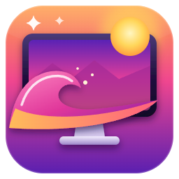
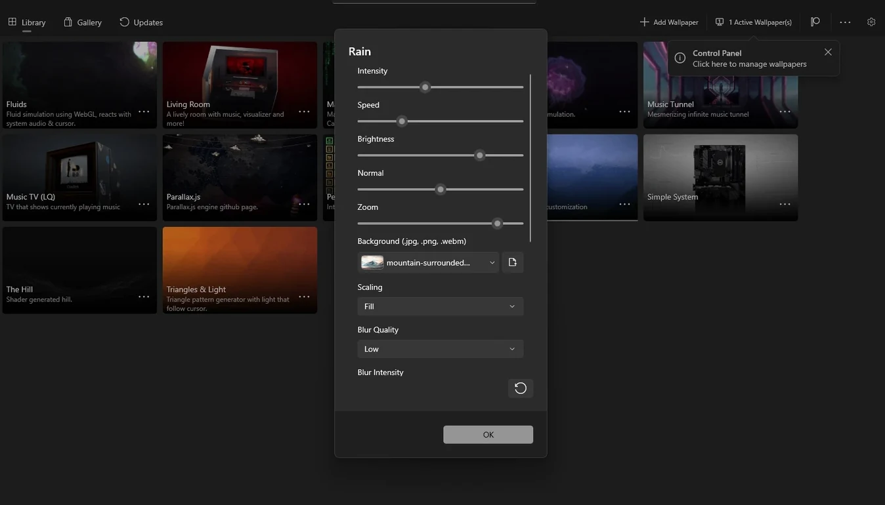

<h1>Live Wallpaper for PC</h1>

Free, open source live wallpaper software for Windows 10 and 11. Set a video, a GIF or a website as your desktop background.

<a href="https://sourceforge.net/projects/live-wallpaper/files/latest/download"><b>Download from SourceForge</b></a>
&nbsp;&nbsp;|&nbsp;&nbsp;
<a href="https://sourceforge.net/projects/live-wallpaper/"><b>SourceForge project page</b></a>
&nbsp;&nbsp;|&nbsp;&nbsp;
<a href="https://viceroyprogress.github.io/live-wallpaper-for-pc/">Website</a>

## About this live wallpaper software

Windows background settings stop at pictures and slideshows. This app plays moving content behind your desktop icons: a video, a GIF, a webpage, or even a Unity or Godot game.

It is free, with no features locked behind a paywall, and it pauses itself during fullscreen games and on battery, so CPU and GPU usage stays near zero when you need the power elsewhere.

## Download from SourceForge

The app is distributed through its [SourceForge project page](https://sourceforge.net/projects/live-wallpaper/).

1. [Download the ZIP from SourceForge](https://sourceforge.net/projects/live-wallpaper/files/latest/download).
2. Extract it to any folder.
3. Run the app. There is nothing to install.

**Requirements:** Windows 10 or Windows 11.

## How to set live wallpaper on Windows

Drag what you want onto the window to set it, or click **Add Wallpaper**. Your wallpapers are kept in the **Library**.

| What you want on your desktop | What to add | Good for |
| --- | --- | --- |
| A video | A video file | Your own clips as a moving desktop wallpaper |
| A GIF | A GIF file | Animated images that Windows would show as a still picture |
| A website | A link | Interactive web wallpapers |
| A game | A Unity or Godot game | A background you can play with |

Step-by-step guides:

- [How to set a video as wallpaper on your PC](https://viceroyprogress.github.io/live-wallpaper-for-pc/set-video-as-wallpaper/)
- [How to set a GIF as wallpaper on your PC](https://viceroyprogress.github.io/live-wallpaper-for-pc/set-gif-as-wallpaper/)

## Features

- **Video wallpaper:** set any video as your background, with hardware-accelerated playback.
- **GIF wallpaper:** keep a GIF moving on your desktop.
- **Website as wallpaper:** turn any webpage into a live background.
- **Interactive wallpaper:** web wallpapers can respond to your cursor and system audio, and Unity or Godot games can run as your background.
- **Drag and drop:** drop a file or link onto the window to set it.
- **Per-wallpaper settings:** adjust wallpapers that offer options, such as speed or brightness.
- **Automatic pause:** playback stops in fullscreen games and on battery.
- **Multi-monitor support:** use it as dual monitor live wallpaper.
- **Screensaver:** use any wallpaper as your screensaver.

## FAQ

### Is this live wallpaper software free?

Yes. It is free and open source under the GPL-3.0 license, with no features locked behind a paywall.

### Do I need to install it?

No. It is a portable app: download the ZIP, extract it and run the program.

### Will it slow down my games?

Playback pauses when you launch a fullscreen game, keeping CPU and GPU usage near zero until you return to the desktop.

### Is it an alternative to Wallpaper Engine?

Yes. It is a separate, free and open source project that covers the same idea. It is not affiliated with Wallpaper Engine.

### Does it work on Mac or Linux?

No. It is a Windows app.

## Source code

The full source code is available in this repository.

## License

Released under the [GNU General Public License v3.0](LICENSE).
